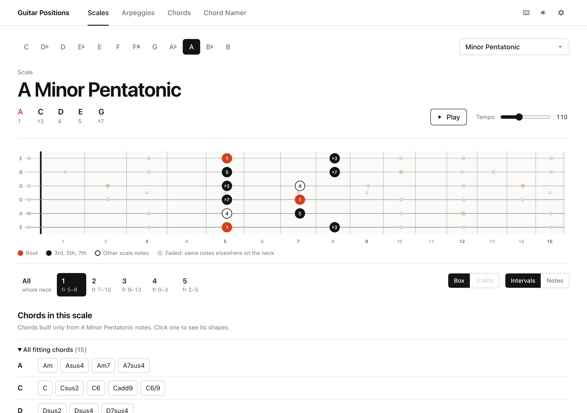
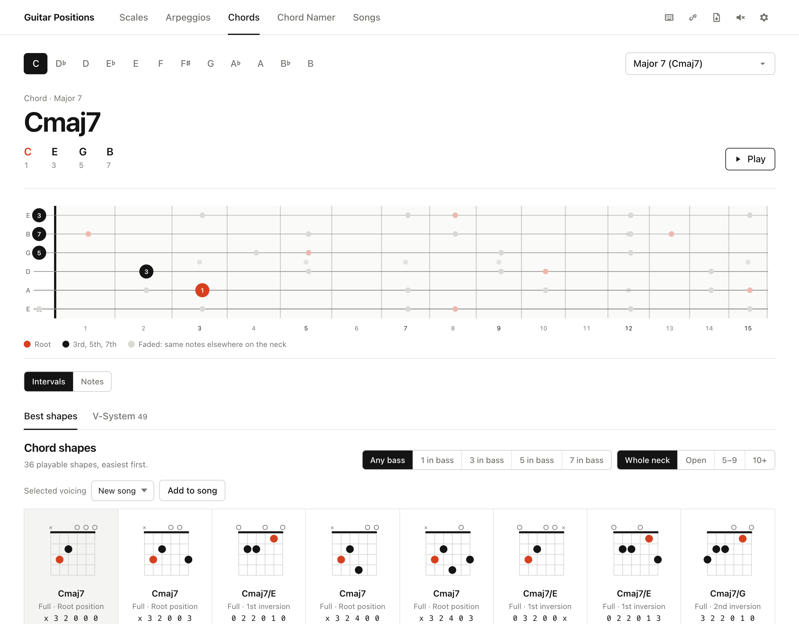
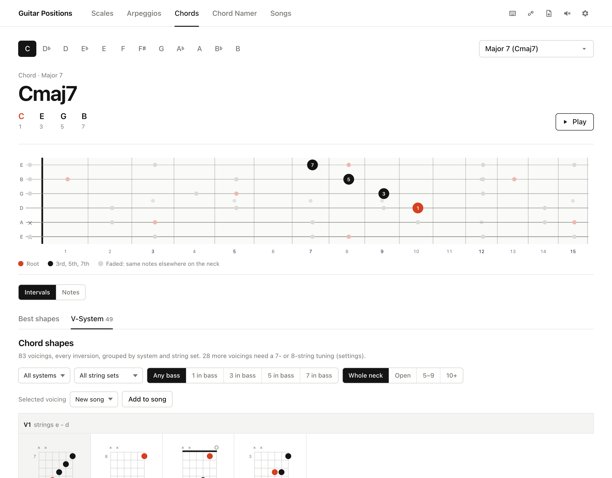
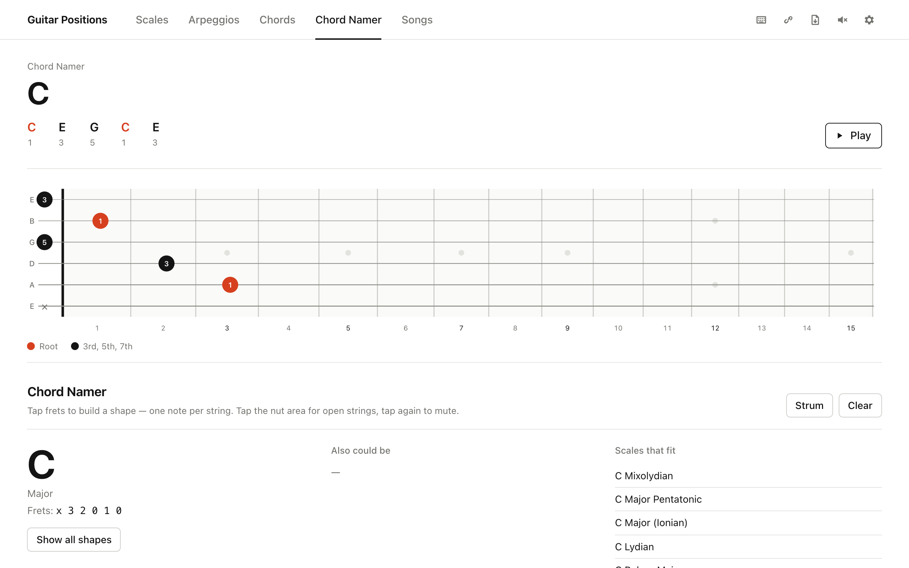
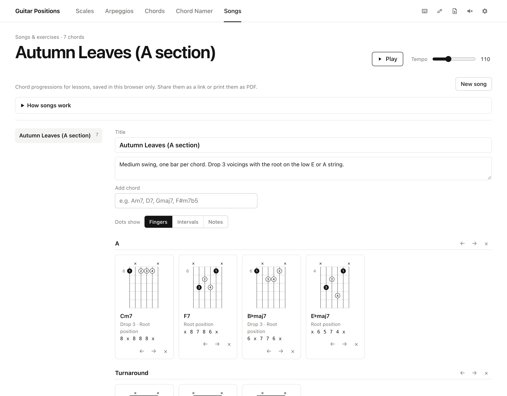

# Guitar Positions

**Interactive guitar fretboard for scales, arpeggios and chords in all 12 keys, with fingerings, playable chord shapes and a chord namer.**

### 🎸 Live: **[fretboard.schoensgibl.com](https://fretboard.schoensgibl.com/)**

Free, no account needed. Installable as a PWA; native apps for iOS, iPad, macOS and Android (not in the stores yet) show the same Studio.

| Scales with positions and fitting chords | Chord shapes |
|---|---|
|  |  |
| **V-System voicings** | **Chord Namer** |
|  |  |
| **Songs & exercises** | |
|  | |

## Features

- **Scales**: modes of major, pentatonic and blues, melodic and harmonic minor families, symmetric scales (whole tone, diminished, Messiaen modes 1–7) and **Bebop** scales. Every scale has numbered positions with fingerings, as boxes (five distinct CAGED-like boxes for 7-note scales) or three notes per string; position 1 is always the lowest one on the neck, in every key.
- **Arpeggios** for every chord type.
- **Chords**: playable shapes ranked by ease, filterable by bass note (inversion) and neck region, plus Ted Greene style **V-System voicings** (V1–V14) for all chord types.
- **Search**: type a chord symbol such as `Em7`, `F#m7b5` or `Maj7#11` and get the chord, its V-System voicings, the arpeggio and fitting scales (Em7 → Dorian, Phrygian, Aeolian on E).
- **Chord-scale theory** after Nettles/Graf: each scale lists the chords it is the chord scale for, with available tensions and avoid notes, plus the diatonic triads and sevenths; search and the Chord Namer suggest scales for a chord the same way. One click opens the shapes.
- **Chord Namer**: tap a shape on the fretboard and get the chord name, alternatives and scales that fit.
- **Songs & exercises**: collect chord progressions for lessons (title, note, sections, chosen voicings). Type a chord such as `Am7` and pick a fingering; diagrams show finger numbers, intervals or note names. Saved in the browser only, no account.
- **Share & print**: every view, including the chosen voicing and songs, can be shared as a link; a PDF button creates a minimalist black-and-white A4 sheet (scale positions, chord shapes or a song).
- **Instruments**: standard tuning, half step down, Drop D, DADGAD, open G/D, 7- and 8-string guitars, left-handed view, horizontal or vertical neck.
- **Sound**: play scales and strum chords; keyboard shortcuts for everything (press `?`).
- **Light and dark theme**, mobile friendly, works offline once installed.

## Tech Stack

- **Backend**: Django (Python 3.8+)
- **Frontend**: Vanilla JavaScript, HTML5, CSS3
- **Database**: PostgreSQL (separate DBs for 6‑string and 8‑string)
- **Data Exchange**: JSON fixtures and REST APIs

## Installation

1. Clone the repository:
   ```bash
   git clone https://github.com/hybridpicker/fretboard-position-finder.git
   ```
2. Create and activate the Conda environment:
   ```bash
   conda create --name fretboard
   conda activate fretboard
   ```
3. Install Python dependencies:
   ```bash
   pip install -r requirements.txt
   ```

## Configuration

In your `settings_dev.py` (or `settings.py`), add:
```python
TEMPLATES[0]['DIRS'] += [BASE_DIR / 'templates']
MEDIA_ROOT = BASE_DIR / 'media'
MEDIA_URL = '/media/'
STATIC_URL = '/static/'
STATICFILES_DIRS = [BASE_DIR / 'static']
STATIC_ROOT = BASE_DIR.parent / 'fretboard' / 'static_cdn'
FIXTURE_DIRS = [BASE_DIR / 'fixtures']
```

## Loading Data

```bash
python manage.py migrate
python manage.py loaddata
# or any other fixture in /fixtures
```

## Running the Development Server

```bash
python manage.py runserver 0.0.0.0:8080
```

Open http://localhost:8080 to view the app, or use the live site at https://fretboard.schoensgibl.com/.

## Tests

```bash
node --test static/studio/js/theory.test.mjs   # music theory and fingering engine
python manage.py test positionfinder           # Django views and catalogue
```

## Native apps

The iOS, iPad, macOS and Android apps (Capacitor, see [`apps/README.md`](apps/README.md) on branch `claude/festive-payne-53db8c`) bundle the same Studio code and must always be rebuilt together with the web version.

## API Endpoints

- `GET /api/scales/?name=<scale>&root=<note>`
- `GET /api/arpeggios/?name=<type>&root=<note>`
- `GET /api/chords/?name=<type>&root=<note>`
- `GET /api/search/?q=<query>`

## Deployment

- **Server**: AlmaLinux 9 with Nginx & Gunicorn, served only at https://fretboard.schoensgibl.com/
- **Development port**: 8080

Example Gunicorn command:
```bash
gunicorn fretboard.wsgi:application --bind 0.0.0.0:8080
```

## License
MIT License

## Fixtures
Fretboard-Position-Finder loads all fingerings, that are stored as **fixtures** with the migrate-command:
```python
python manage.py migrate
```
